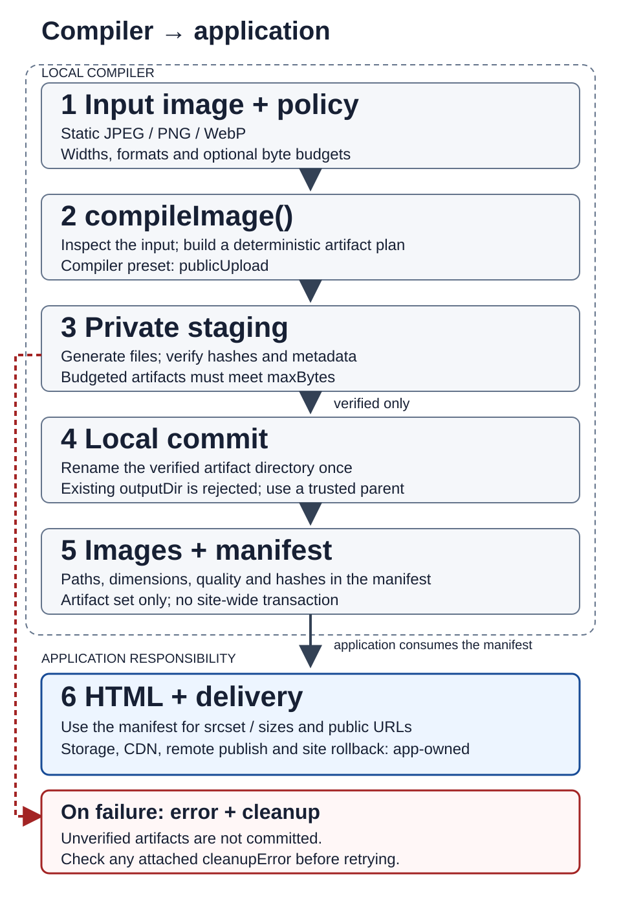

# Adoption guide

Choose a complete artifact set for uploads/builds, or an individual output when
that is all your application needs. Install the [Node package](../README.md#install)
first. Code examples below use ESM and top-level `await` in a `.mjs` file.

## Start with a public artifact set

Create a new destination beneath an existing, trusted parent directory:

```javascript
import { compileImage } from '@alberteinshutoin/lazy-image';

const manifest = await compileImage({
  inputPath: './uploads/photo.jpg',
  outputDir: './public/images/photo-v1',
  policy: { widths: [320, 640], formats: ['webp'], placeholder: true },
});
console.log(manifest);
```

For a source at least 640 pixels wide, this produces:

```text
photo-v1/
  image-320.webp
  image-640.webp
  placeholder.webp
  manifest.json
```

The compiler does not enlarge smaller sources. It normalizes the requested widths;
read the actual artifacts from the manifest rather than assuming every requested
width was produced. See [compiler policy](./API.md#compiler-policy) for defaults,
byte budgets and input restrictions.

### Use the CLI

Save this as `policy.json`:

```json
{"widths":[320,640],"formats":["webp"],"placeholder":true}
```

```bash
npx @alberteinshutoin/lazy-image compile uploads/photo.jpg \
  --out-dir public/images/photo-v1 --policy policy.json
```

The CLI uses the same compiler contract. Success writes manifest JSON to stdout;
diagnostics go to stderr. Exit codes: `0` success, `2` invalid arguments or policy
JSON, `1` compiler failure. Use a new output directory for each compilation.

### Publish through your application

The compiler checks files in private staging, then commits the directory locally.
The parent must be trusted and must not be replaced concurrently; staging and
output must share a filesystem. Source-snapshot cleanup completes before commit.
A failed compilation does not publish the set. In the JavaScript API, an additional
cleanup failure is attached to the rejected error as `error.cleanupError`; inspect
it along with the primary phase/code. The CLI prints only the primary failure and
does not print the attached cleanup error. CLI stderr alone therefore cannot
confirm that unpublished staging was removed. Do not delete an existing
destination simply to retry.

Your application owns authentication, upload admission, job scheduling, storage
transfer and delivery. Upload the verified files through your existing storage
integration, then make their URLs available to consumers. That remote publication
is separate from the compiler's local transaction. Map manifest-relative paths to
a public prefix; never send private filesystem paths to a browser.

### See the compiler/application boundary



[Open the editable original SVG](./images/compiler-artifact-flow.svg) and zoom for
the detailed labels. The diagram is an original MIT-licensed guide asset. The
compiler commits the image/manifest directory; HTML generation, storage/CDN
transfer, remote publication and whole-site rollback remain application work.

Use SVG as the standard format for this diagram. The
[published 1.5.0 evaluation](./history/adoption-diagram-1.5.0-20261014/DECISION.md)
checked a planned desktop viewport of 1440×1000 with a 960px CSS image and a
390×844 mobile viewport with 24px side padding (342px image), each at DPR 1/2.
Mobile normal display communicates the six stages; detailed labels require opening
and enlarging the original. These are the guide's chosen display conditions, not
observations of a production site or physical phones.

For example, a page that hosts the SVG can provide a direct original-image link:

```html
<style>
  .compiler-diagram { max-width: 1008px; padding: 24px; margin: auto; box-sizing: border-box; }
  .compiler-diagram img { display: block; width: 100%; max-width: 960px; height: auto; }
</style>
<div class="compiler-diagram">
  <a href="compiler-artifact-flow.svg" target="_blank" rel="noopener">
    
  </a>
  <p><a href="compiler-artifact-flow.svg">Open the original and zoom for details</a></p>
</div>
```

If your publishing pipeline requires raster images, rasterize the white-background
SVG to an opaque 1920px-wide PNG with an external tool first. `compileImage()`
accepts static JPEG/PNG/WebP inputs; SVG/PDF input and PNG output are not compiler
policy features. The [fixed comparison policy](./history/adoption-diagram-1.5.0-20261014/consumer/policy-B.json)
produces WebP and JPEG at 684/960/1920px, with these explicit limits:

| Width | WebP maxBytes / maxQuality | JPEG maxBytes / maxQuality |
|---|---|---|
| 684 | 102400 / 80 | 153600 / 85 |
| 960 | 204800 / 80 | 307200 / 85 |
| 1920 | 409600 / 80 | 614400 / 85 |

WebP is the primary raster choice for this diagram; JPEG is an optional opaque
fallback. 684px covers 342 CSS px at DPR2, 960px covers the desktop CSS width at
DPR1, and 1920px covers it at DPR2. The smallest tested readable candidate was
684px; it is enlarged when displayed at 960 CSS px, so retain the larger variants
for desktop rather than treating that result as an optimum for all diagrams.
Build raster `srcset` from the actual manifest and use CSS widths in
`sizes="(max-width: 1008px) calc(100vw - 48px), 960px"`. Browser selection can reuse
a larger cached variant; check `currentSrc` rather than assuming a particular file.

For a raster-only page, keep the CSS slot and `sizes` in agreement (the paths
below stand for the corresponding manifest artifacts):

```html
<style>
  body { margin: 0; }
  main { box-sizing: border-box; max-width: 1008px; margin: auto; padding: 0 24px; }
  img { display: block; width: 100%; max-width: 960px; height: auto; }
</style>
<main>
  
</main>
```

In the [saved Chrome evaluation](./history/diagram-srcset-transfer-20261016/evaluation-20261018/RESULTS.md),
three cold trials per condition selected 684px at mobile CSS342/DPR1–2,
960px at desktop CSS960/DPR1, and 1920px at desktop DPR2. Image response bodies
were 65.41%, 48.45%, and 0% smaller respectively than the fixed 1920px control.
These are this diagram's observed body-byte comparisons, separate from its
345,298-byte three-candidate storage and from Resource Timing `transferSize`.
After priming 1920px, all three mobile DPR2 trials selected that cached image
but also downloaded 684px (64,168 body bytes). Account for every candidate
request, including extra downloads; `currentSrc` or its zero `transferSize`
alone does not establish total page image transfer. This desktop Chrome
emulation on loopback establishes neither phone/all-browser behavior nor
speed, LCP, CDN savings or an SLA.

The budgeted six-artifact call took about 1.33–1.35 seconds in three M4 trials;
rendering the SVG and inspecting it were outside that timing. All 18 budgeted
artifacts fit, and their image bytes/hashes matched the unbudgeted reference.
This does not establish extra compression, universal acceptance or a latency SLA.
`maxQuality` limits the search ceiling, not minimum perceptual quality or runtime.
If a different input/budget changes the selected quality or bytes, check the final
labels and arrows again. Preserve `E123`/`E300` failures; do not raise the compiler
resource limit or publish a failed set to force success.

## Build a static page from the manifest

The [static-site example](../examples/compile-image-static-site.mjs) compiles one
local image, then builds a page from the returned manifest. It uses the same
public API; it does not implement another image verifier or staging transaction.
Use Node.js 22 or newer on a [supported native platform](./COMPATIBILITY.md).

From a checkout with a current native build:

```bash
mkdir -p public
node examples/compile-image-static-site.mjs \
  test/fixtures/test_100KB_1057x1057.jpg public/photo-v1
node examples/compile-image-static-site.mjs --self-test
```

The default policy requests widths `[320, 640, 960]`, WebP, and a placeholder.
To supply another compiler policy, pass a JSON file as the third argument:

```json
{"widths":[320,640],"formats":["webp"],"placeholder":true}
```

```bash
node examples/compile-image-static-site.mjs input.jpg public/photo-v2 policy.json
```

The output is `index.html` beside `images/manifest.json`, the compiler-owned image
files, and the optional placeholder. The page maps each manifest-relative path
under `images/`; its `srcset`, image dimensions and placeholder URL come from the
actual manifest. Requested widths are not filenames. A 64px-wide input produces
a 64px variant with this default policy, rather than links to absent 320/640/960px
images. The script does not put input/output filesystem paths in HTML.
For multiple formats it orders picture sources AVIF, then WebP, with JPEG as the
compatible `img` fallback when present; source preference is not a size/quality claim.

Serve **only the generated site directory**, for example with Python's standard
static server (Python 3 is needed only for this preview command):

```bash
python3 -m http.server 8080 --bind 127.0.0.1 --directory public/photo-v1
# Open http://127.0.0.1:8080/ and inspect the image and Compiler manifest link.
```

This relative URL layout is application code. Your site build and hosting own URL
placement and delivery. The compiler commits only the `images/` set; HTML is
written afterwards. If HTML writing fails, verified images may remain without a
page. This example is not a transaction for an entire site or a multi-image job.
Use an existing trusted parent, do not replace it concurrently, and always choose
a **new** site directory. Existing directories are rejected before any write to
their contents; the example never deletes or overwrites them.

Success exits `0`; argument/policy, compilation or HTML errors exit `1` and report
the phase/code, recovery hint when available, and any attached cleanup error on
stderr. Invalid input and an unmet strict budget produce no success page. A
failure can leave the new empty site directory, or verified images if page writing
failed; inspect the diagnostic and use a new destination after correcting the
input/policy/permissions. Do not remove a prior site simply to retry. The
`--self-test` checks command exits, manifest/files/page references, no-upscale,
invalid input, strict budget failure, and byte-for-byte preservation on a retry
against an existing site. Browser decoding/display is a separate preview check.

To try the same example against the fixed **published** package outside a checkout,
copy `examples/compile-image-static-site.mjs` and `examples/_load.mjs` into a new
directory, then:

```bash
npm init -y
npm install --save-exact --registry=https://registry.npmjs.org @alberteinshutoin/lazy-image@1.5.0
node compile-image-static-site.mjs /path/to/input.jpg ./site-v1
python3 -m http.server 8080 --bind 127.0.0.1 --directory ./site-v1
```

`--self-test` uses repository fixtures and is intended for the checkout. The
[recorded 1.4.3 integration trial](./history/STATIC_SITE_ADOPTION.md) includes published
installation provenance, commands, failures and browser evidence. It is a
technical reproduction, not an independent user's adoption or performance claim.
The [published 1.5.0 six-image blog evaluation](./history/blog-adoption-1.5.0-20261013/DECISION.md)
records a complete sequential article build with explicit byte budgets and quality
ceilings. Its fixed M4 workload met all budgets in three trials with a maximum
process time of about 2.11 seconds. Budgeted and unbudgeted image bytes were
identical; the benefit was an explicit capacity constraint, not extra compression.
Adoption is conditional on checking real inputs and fine-line diagrams at their
actual display sizes. This is a laboratory reproduction, not an independent user's
adoption or a processing-time guarantee.

If a comparison page reports `EncodingError`, inspect each image's decode result,
selected URL, HTTP response and body identity. `complete=true` and HTTP 200 alone
do not prove successful decoding. Register load/error observers before image
requests, and keep timeout or source changes separate from success. The
[decode investigation](./history/decode-comparison-20261014/RESULTS.md) could not
reproduce the earlier two failures with the stored bytes and pages; their
historical causes remain unknown. Its independent fetch/Blob checks do not prove
what the original failed image requests received.

The [existing build-time batch example](../examples/build-time-optimize.mjs)
optimizes several files using `ImageEngine` and reports metrics; it does not
provide the compiler manifest-to-page flow demonstrated here.

## Optimize one image

Use the asynchronous file constructor in servers so source setup runs off the
Node.js event loop:

```javascript
import { ImageEngine } from '@alberteinshutoin/lazy-image';

const image = await ImageEngine.fromPathAsync('./uploads/photo.jpg');
await image
  .sanitize({ policy: 'public-upload' })
  .resize({ width: 1600, height: 1600, fit: 'inside' })
  .toFile('./public/photo.webp', 'webp', 80);
```

`public-upload` strips EXIF/GPS/XMP and keeps only validated ICC within the policy
limits. It is not the same as publishing a verified multi-file set.
See [metadata behavior](./METADATA_SUPPORT.md).

| Input/output choice | Use when | Cost or constraint |
|---|---|---|
| `fromPathAsync()` → `toFile()` | Input and output are files | Source bytes stay Rust-owned; decoded pixels still use native memory |
| `from(buffer)` → `toBuffer()` | The caller needs in-memory bytes | Input is copied into Rust; encoded output becomes a Node Buffer |
| `createStreamingPipeline()` | Existing integration requires streams | Stages input/output on disk; not incremental decode/encode |

Writing an already-buffered upload to disk does not undo its memory allocation.
Bound upload admission and concurrency. For large mutable sources, use a stable
copy; see [file memory and mmap rules](./ZERO_COPY.md).

## Build several outputs

Use `compileImage()` for a publication contract; use `clone()`, responsive helpers
or batch APIs when your application manages output names and partial failures.
The general responsive helpers can enlarge images and do not promise the compiler's
transaction. See [API](./API.md#responsive-output-helpers).

Runnable examples are maintained separately:

- [Build-time batch](../examples/build-time-optimize.mjs): metrics and failure reporting.
- [Compiler static page](../examples/compile-image-static-site.mjs): one image's verified manifest consumed by HTML.
- [Upload endpoint](../examples/upload-sanitize-server.mjs): raw uploads and error mapping.
- [Observability](../examples/metrics-observability.mjs): structured metrics logs.

## Byte budgets and compute limits

Published version 1.5.0 contains a compiler quality ceiling and
JPEG/byte-budget/metrics corrections. The static-page install command above pins
published 1.5.0; the recorded 1.4.3 integration trial remains historical evidence
for that earlier implementation. See the [1.5.0 publication verification](./history/V1.5.0_VERIFICATION.md)
for published-package provenance, runtime checks, and remaining limits.
Read the [1.5.0 release notes](./history/V1.5.0_RELEASE_NOTES.md) and the
[dated operational evaluation](./history/target-bytes-operational-20261012/EVALUATION.md).

A byte-feasible output does not guarantee the compiler can search for it within
its resource policy. `compileImage()` and the CLI use `public-upload`'s cumulative
5-second inter-stage limit. Codec calls are not forcibly interrupted mid-encode.
The corrected search tries qualities from high to low; tight or impossible budgets
can consume more work before success or refusal. A valid input that hits `E123`
is a resource refusal, not successful hostile-input rejection.

For the compiler, choose `widths`, `formats`, `budgets`, and `placeholder` to match
the job. Each budget can opt into `maxQuality`, an integer 30–100 (default 100).
The compiler selects the highest byte-fitting quality in 30..maxQuality and
verifies it before publication. It has no `minQuality` or timeout policy field.
On `E300`, reconsider the requested width/format, required quality, and byte limit.
On `E123`, report a failed job and reconsider width/format/output count or job
design; do not blindly retry, reset the timer, or publish a partial candidate.
Increasing a byte limit is an application policy decision, not an automatic fallback.

For example, keep the same byte limit and explicitly exclude quality above 90:

```js
const policy = {
  widths: [1600], formats: ['jpeg'], placeholder: false,
  budgets: [{ width: 1600, format: 'jpeg', maxBytes: 93782, maxQuality: 90 }],
};
```

Use this object with `compileImage()` or save it as CLI `--policy` JSON.
Omission and explicit 100 have identical normalized policy semantics. A ceiling
can reduce search work but does not guarantee completion within five seconds.
`maxQuality: 60` is an encoder setting, not 60% perceptual quality or lossless output.
Choosing it excludes higher-quality candidates even if one could fit the bytes.

For individual `ImageEngine` outputs, existing `minQuality`/`maxQuality` options
can bound the search. The evaluation's JPEG1600 example accepted its 93,782-byte
limit with `minQuality: 40`, `maxQuality: 90`, and `strict: true` in three trials.
That choice excludes quality above 90 and returns one file; it does not provide
the compiler's verified set/manifest and is not a universal latency guarantee.
Standalone best-effort callers must explicitly check `budgetMet` before delivery.

The [maxQuality evaluation](./history/compiler-budget-max-quality-20261012/EVALUATION.md)
accepted JPEG1600/max90 and AVIF320/max60 in all three API and CLI trials with
the same byte limits. Publication preparation can proceed for this explicit-policy
contract; omitted ceilings still produced resource refusals in those workloads.
The option does not fix default-policy timeouts or approve a release. Evaluate
your own deployment; three single-concurrency M4 trials are not p99, an SLA, or OOM proof.

## Deploy and measure

Use the native package on its [supported Node platforms](./COMPATIBILITY.md).
V8 isolates require the separate [Wasm preflight package](./WASM_PACKAGE_API.md),
which does not expose the Node compiler. Match platform/architecture/libc to the
installed native package; verify installation in the actual deployment image.

Size memory, temporary disk, concurrency and timeouts from representative inputs.
Do not assume avoiding a V8 copy prevents OOM or that a smaller native binary
establishes lower cold-start latency. Use [metrics](./metrics-api.md),
[thread configuration](./THREAD_MODEL.md) and [performance evidence](./PERFORMANCE.md).
For failures, start with [troubleshooting](./TROUBLESHOOTING.md).
